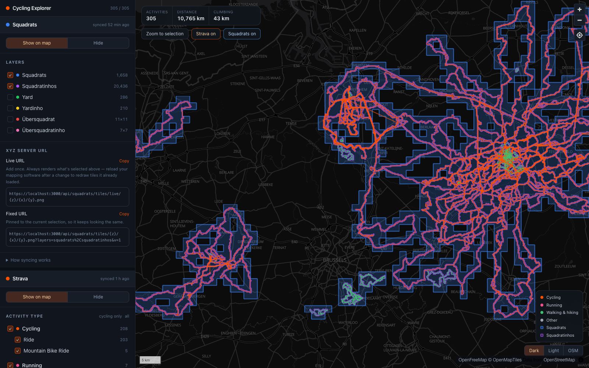
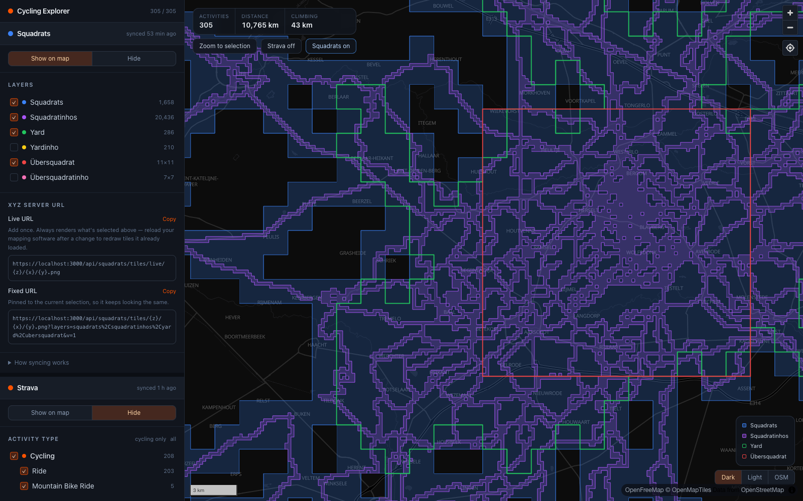
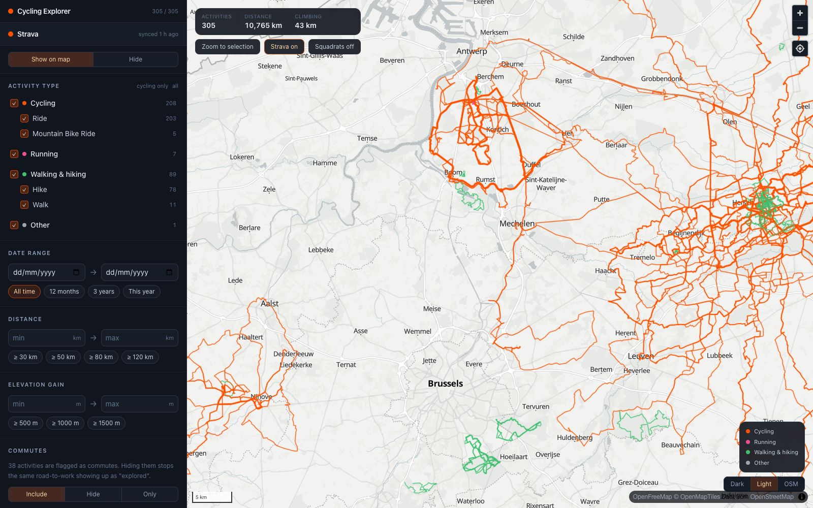

# Cycling Explorer

Every [Strava](https://www.strava.com) activity on one map, filterable, with your
[Squadrats](https://squadrats.com) tiles as a layer you can toggle underneath — plus two ways to
get "roads I've already ridden" into your mapping software:

1. **A live XYZ tile overlay** served by this app at `/api/tiles/{z}/{x}/{y}.png`, honouring
   whatever filters you have set — or at `/api/tiles/live/{z}/{x}/{y}.png`, which always follows
   the sidebar's current settings.
2. **A multi-track GPX export** of the filtered activities.

Squadrats get their own XYZ URL too, so your mapping software can show both overlays at once.

Runs entirely on your machine. Tokens, cached activities and Squadrats tiles live in `./data`
(gitignored).



| Squadrats: yard and übersquadrat outlines | Strava: filters on a light basemap |
| --- | --- |
|  |  |

```bash
npm install && npm run dev
```

`npm run dev` runs Next with `--experimental-https`, which uses mkcert to mint a
locally-trusted certificate. **The first run prompts for your macOS password** to install the
local CA — that's needed for the overlays to work in web-based mapping software (see below). Then open
<https://localhost:3000>.

Use `npm run dev:http` if you only want the map and the GPX export and would rather skip the
certificate.

## Getting your data in

Two routes. The app works the same either way — the store is the seam, so the map, filters,
tile server and GPX export don't care where the data came from.

### Browser extension (no subscription)

Since **1 June 2026 a paid Strava subscription is a prerequisite for creating an API
application**, so the official API is closed to free accounts. The extension in `extension/`
sidesteps that by reading the same endpoints Strava's own web app uses, with the session
you're already logged in with.

1. Open `chrome://extensions`, turn on Developer mode, choose **Load unpacked**, and pick the
   `extension/` folder.
2. Log in to strava.com in that browser.
3. Click the extension's toolbar button. A progress panel appears bottom-right.
4. Reload this app.

It asks the app which activity ids it already has and only fetches streams for the rest, so
a large backfill is resumable — stop it any time and click again later. Requests to Strava
are spaced 700 ms apart, and progress is flushed to the app every 20 activities so a stopped
or crashed run keeps what it got.

`extension/strava.js` is self-contained and has no extension-specific APIs in it, so you can
also paste it straight into the DevTools console on strava.com for a one-off. Set
`window.__CYCLING_EXPLORER_ORIGIN` first if the app isn't on port 3000.

Two things worth knowing:

- **Strava's terms don't sanction reading these endpoints outside the official API**, even
  for your own data, and their anti-scraping stance tightened in 2026. Personal, local,
  read-only use is a defensible position but it's your account and your call.
- The endpoints are undocumented and their field names drift. The importer therefore trusts
  the list JSON for almost nothing: distance comes from the `distance` stream, elevation is
  computed from the `altitude` stream, and sport type accepts either a key (`GravelRide`) or
  a display name (`Gravel Ride`). The script logs its first list row to the console so a
  mismatch is obvious.

### Squadrats (same extension)

Open squadrats.com and click the same toolbar button. On squadrats.com it runs
`extension/squadrats.js` instead of the Strava sync:

1. It works out your Squadrats user id: from the URL on a `/u/<id>` or `/map/<id>/…` page,
   else from the user you're signed in as (Squadrats signs in with Firebase, which keeps the
   current user in the site's own storage — only the uid is read), else the id the app stored
   last time, else a single profile link on the page, else it asks. The browser console logs
   which source it used.
2. It downloads your visited tiles from Squadrats' anonymous, CORS-open endpoint
   (`mainframe-api.squadrats.com/anonymous/squadrants/<id>` — unofficial, note the spelling),
   plus the "trophies" GeoJSON that response links to, which holds the yard, yardinho,
   übersquadrat and übersquadratinho outlines.
3. It posts both to `POST /api/squadrats`, which replaces whatever was stored. Every sync is a
   full snapshot, and takes a couple of seconds.

No session or credentials are involved: that endpoint serves any user's tiles by id. It runs in
the extension's isolated world rather than the page, so squadrats.com's Content-Security-Policy
can't block the request to localhost. If the trophies download fails you still get squadrats
and squadratinhos; sync again later for the outlines.

The app needs no reload after either sync: it re-checks `/api/status` whenever its tab regains
focus and reloads if anything changed.

### Official Strava API

If you do have a subscription, this is the sanctioned route and it syncs incrementally on its
own. Create an app at [strava.com/settings/api](https://www.strava.com/settings/api) with
**Authorization Callback Domain** `localhost`, then:

```bash
cp .env.local.example .env.local   # fill in client ID + secret
```

Leave *View data about your private activities* ticked when authorising, otherwise rides
marked "Only me" are missing from the map.

- **Cache-first.** **Sync new** passes `after=<newest stored activity − 7 days>` so it only
  fetches what's new; the week of overlap catches backdated uploads and edits.
- **Rate limits.** 100 reads per 15 minutes, 1000 per day. Progress streams live including
  current usage, and a 429 leaves everything fetched so far already saved.

## Resolution, and why the two routes differ

The API's `summary_polyline` is a simplified track — one request per 200 activities, but
coarse. The web `streams` endpoint returns the **full ~1 Hz trace** plus altitude, at the cost
of one request per activity.

Imported streams are simplified to a 15 m tolerance before storage (`DEFAULT_TOLERANCE_METERS`
in `src/lib/webImport.ts`). Roads are about 10 m wide, so that keeps them distinguishable
while cutting a 5 000-point ride to a few hundred — full streams for a decade of riding would
be millions of points and would bog down both the store and the map. Raise it for smaller
files, lower it for more fidelity.

Elevation gain is derived from the altitude stream with smoothing plus hysteresis (only
counting a climb once the trace turns back down by >3 m). Summing raw deltas overcounts badly
— on a test profile that truly climbs 110 m, naive summing gave 367 m while this gives 111 m.
Rolling bumps under ~3 m go uncounted, and it will never match Strava's barometric figure
exactly.

Activities with no GPS trace (indoor rides, gym sessions) are skipped either way.

**Filtering happens once, in one place.** `src/lib/filters.ts` is shared: the browser applies
it for instant map updates, and the tile and GPX endpoints apply the same code to the same
data, so the overlay always matches what you see.

## Squadrats on the map

Squadrats are exactly Web Mercator slippy tiles — a squadrat is a zoom-14 tile (~1.5 km), a
squadratinho a zoom-17 tile (~200 m) — so the app stores them the way the API returns them, as
`"x-y"` tile ids, and draws them straight from that grid: each visited cell filled, and a line
along every cell side that borders an unvisited one, which is the outline of the whole area,
holes included. The yard/übersquadrat outlines are drawn from the trophies polygons.

`src/lib/squadratTiles.ts` renders them as raster tiles at
`/api/squadrats/tiles/{z}/{x}/{y}.png`, used both by this app's map (at `scale=2`, under the
activity lines) and by your mapping software. Same in-process LRU as the activity tiles.

| Param | Meaning |
| --- | --- |
| `layers` | comma-separated: `squadrats`, `squadratinhos`, `yard`, `yardinho`, `ubersquadrat`, `ubersquadratinho`. Default: the first two |
| `scale` | `2` for 512 px tiles on high-DPI screens |
| `v` | cache-buster; the UI sets it to the Squadrats data version |

Like the activity overlay, there are two URLs, both in the sidebar's Squadrats group under
**XYZ server URL**:

- **Live URL** — `/api/squadrats/tiles/live/{z}/{x}/{y}.png`, always rendering the layers
  ticked in the sidebar (pushed to `PUT /api/squadrats/tiles/live`, persisted in
  `data/live-squadrats.json`).
- **Fixed URL** — the URL above with `layers` baked in.

## The activity overlay

Most mapping software can add a custom XYZ (a.k.a. "tile" or "TMS") layer: paste a URL
template with `{z}/{x}/{y}` and set it as an **overlay** so it draws on top of the basemap.
The sidebar builds that URL for you with the current filters baked in, plus a **Preview**
button that renders the actual tile endpoint on this app's own map so you can check it before
pasting.

Two URLs are offered:

- **Live URL** — `/api/tiles/live/{z}/{x}/{y}.png`. Add it to your mapping software once; it renders with
  whatever filters and style the sidebar currently has. The UI pushes every change to
  `PUT /api/tiles/live` (persisted in `data/live-overlay.json`, so it survives a restart;
  `GET` shows the current config). Tiles are served `no-store`, but most mapping software keeps
  tiles it already drew in memory — reload it after a change.
- **Fixed URL** — `/api/tiles/{z}/{x}/{y}.png?…` with the settings baked into the query
  string, for a layer that should keep looking the same.

Fixed tile URL parameters — all optional:

| Param | Meaning |
| --- | --- |
| `from`, `to` | `YYYY-MM-DD`, inclusive |
| `types` | comma-separated Strava `sport_type` values |
| `minDistance`, `maxDistance` | kilometres |
| `minElevation`, `maxElevation` | metres of climbing |
| `commute` | `include` (default), `exclude`, `only` |
| `color` | 6-digit hex, no `#` |
| `opacity` | 0.05–1 |
| `weight` | 0.25–6, multiplies the zoom-derived line width |
| `glow` | `0` to drop the halo and get crisper lines for tracing |
| `v` | cache-buster; the UI sets it to the data version |

### Why local HTTPS is required

Web-based mapping software is served over https. Chrome blocks `http://localhost`
subresources on an https page as **mixed content** — verified in Chrome 150: both `fetch()`
and `` loads of `http://localhost:3111/api/tiles/...` from an https mapping site fail.
Safari/WebKit allows the same request. Notably this is *not* Chrome's newer Local Network
Access gate — `navigator.permissions.query({name: 'local-network-access'})` reports `granted`
on that site, so loopback access itself is fine; it's purely the scheme. Desktop and mobile
apps don't have this restriction.

Serving this app over https removes the mismatch, which is why `npm run dev` enables it.
Because the app derives its own base URL from the request origin, loading it at
`https://localhost:3000` automatically produces `https://...` tile URLs — no config needed.
Running on a different port works too.

Tiles are rendered with `@napi-rs/canvas` and memoised in-process, keyed by data version +
filters + style, so panning around your mapping software is cheap after the first pass. A cold tile at
low zoom takes ~45 ms; a cached one ~10 ms.

## Alternatives considered for the tile server

Building the endpoint into this app won because the filters and the activity cache already
live here — a separate service would need the data pushed to it and the filters duplicated.
If you outgrow it:

- **[hotpot](https://github.com/erik/hotpot)** — Rust heatmap tile server for GPX/TCX/FIT,
  with an XYZ endpoint, HTTP POST ingest and Strava webhook support. Renders tiles in ~1 ms
  and runs on the smallest Fly instance. The leanest choice for a long-running standalone
  endpoint, and the right move if you want tiles available off your laptop.
- **[local-heatmap-tile-server](https://github.com/c0nsumer/local-heatmap-tile-server)** —
  Docker, nginx in front of on-disk tiles, a dashboard, pre-rendering, and **PMTiles export**.
  The PMTiles angle is interesting: a single static file you could host anywhere, no server.
- **[strava-heatmap-proxy](https://github.com/erik/strava-heatmap-proxy)** — if you'd rather
  use Strava's *own* personal heatmap tiles. There's no official API for them; it needs your
  `_strava4_session` cookie and re-mints CloudFront cookies from a Cloudflare Worker. Gives
  you Strava's rendering but no filtering — the opposite trade-off from this app.

## Other ways to get the data out

- **Bulk export.** Settings → My Account → *Download or Delete Your Account* → Request your
  archive. Free and sanctioned, gives `activities/` (GPX/FIT/TCX, some gzipped) plus
  `activities.csv`. A one-off snapshot rather than ongoing sync, and FIT needs a decoder.
- **intervals.icu.** Syncs from Strava under its own API registration and exposes a personal
  API key, so it can act as a sanctioned intermediary for ongoing sync. Needs an account
  there.

## GPX export

`/api/export/gpx` streams one `<trk>` per activity so each ride stays individually selectable
in your mapping software. Filters apply, and `simplify=<metres>` runs Ramer–Douglas–Peucker to shrink the
file — 25 m tolerance cut a test export to about a fifth with no visible change at
road-tracing zoom. The sidebar shows track count and estimated size, and warns past the point
where mapping software tends to get sluggish.

Tracks carry no timestamps, and no elevation for API-sourced activities.

## Layout

```
extension/
  manifest.json    MV3 manifest — scripting + activeTab, strava.com + squadrats.com
  background.js    on click: strava.js on strava.com, squadrats.js on squadrats.com
  strava.js        the whole Strava sync: list paging, streams, throttle, batching, overlay UI
  squadrats.js     the whole Squadrats sync: user id, tiles + trophies, post to the app
src/lib/
  strava.ts        OAuth, token refresh, paged activity fetch, rate-limit parsing
  webImport.ts     normalises extension payloads; elevation gain, distance, sport types
  store.ts         JSON persistence + in-memory cache (activities, tokens, squadrats)
  squadrats.ts     Squadrats layers, import validation, tile URL — shared client and server
  squadratTiles.ts Squadrats tile rasterisation from the tile grid + outline polygons
  filters.ts       filter type, parse/serialise, matching — shared client and server
  polyline.ts      encoded-polyline encode/decode, RDP simplification, bbox helpers
  tiles.ts         web mercator, geometry cache, activity tile rasterisation, LRU
  tileResponse.ts  z/x/y validation + PNG response shared by every tile route
  liveOverlay.ts   the sidebar's current config per overlay, for the live tile URLs
  overlay.ts       activity tile style + fixed/live URL building
  gpx.ts           GPX 1.1 generator
src/app/api/
  auth/*           OAuth start, callback, disconnect
  status           connection + dataset summary
  sync             SSE incremental/full sync via the official API
  import           GET known ids · POST activities from the extension (CORS-enabled)
  activities       full cached set (polylines still encoded; client decodes once)
  export/gpx       filtered GPX download
  tiles/[z]/[x]/[y]  transparent PNG tiles, CORS-enabled
  tiles/live       GET/PUT the config behind the live URL
  tiles/live/[z]/[x]/[y]  same tiles, rendered with the live config
  squadrats        GET stored summary · POST a snapshot from the extension (CORS-enabled)
  squadrats/tiles/[z]/[x]/[y]  Squadrats PNG tiles, CORS-enabled
  squadrats/tiles/live        GET/PUT the layers behind the Squadrats live URL
  squadrats/tiles/live/[z]/[x]/[y]  same tiles, with the live layers
```
